<!--
  This is your post body, written in plain Markdown. Delete this comment
  block once you're done reading it - it won't render (it's an HTML
  comment, passed through untouched).

  - Inline math:   $e^{i\pi} + 1 = 0$
  - Display math:  $$ \int_0^1 x^2\,dx = \tfrac{1}{3} $$
  - Captioned image (the caption goes inside the [] brackets):
      
  - Uncaptioned image (leave the [] brackets empty):
      

  Put images anywhere inside this post's own folder - images/ is just a
  convention, not a requirement. Give each image its own paragraph (blank
  line before and after) so it gets wrapped as a proper figure.
-->

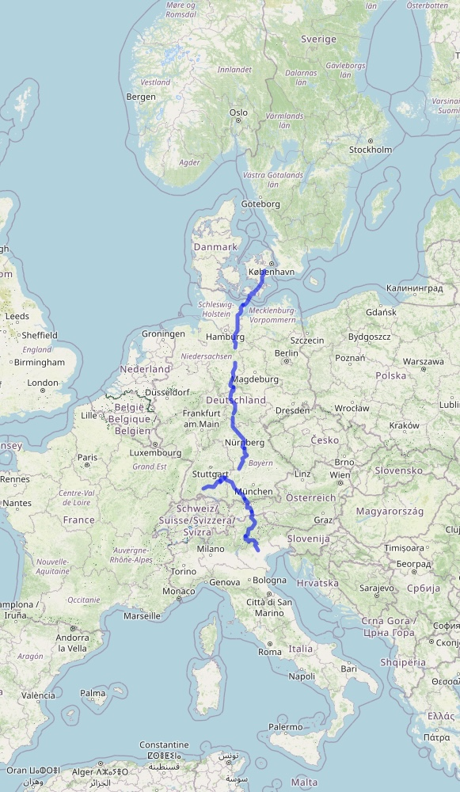

This summer I cycled 1700km from Copenhagen to my hometown, Onara, in Italy. It took eleven days, detours included. I had big plans before leaving. I wanted to make a YouTube video but never bought the equipment. I started posting daily recaps on Instagram but quit after two days because it felt like bragging. So here's a blog post instead. It's October, I'm already forgetting things, and I want future Federico to have this written down somewhere. 

As a kid, I spent my afternoons watching the Giro and the Tour (I still do to be fair). Watching the riders cross such different landscapes taught me that a bike can take you anywhere, and made me fall in love with the idea of travelling slowly enough to notice the landscape change and to reach places just with your own strenght. When I moved to Copenhagen ten years ago, I promised myself I'd ride home one summer. For years this plan just lived in my head. This year I finally went.  

### The days before the grand departure
Apart from having a few km in my legs, I didn't do much to prepare for the adventure. As my friend François suggested, I sketched a route, split it into stages, and set myself one loose goal: reach Nürnberg, where some friends live. That alone would already have been a victory. I booked a hotel for the first night in Heiligenhafen, and that was it. The real challenges were all in my head. I had already imagined everything that could go wrong, and my biggest fears were getting bored, getting injured, or breaking the bike. So, just in case, I studied the (not exactly great) German regional train network as a backup plan. The day before leaving, I packed too many useless things into the bike bags, but luckily my friend Lele helped me bring only the bare minimum.

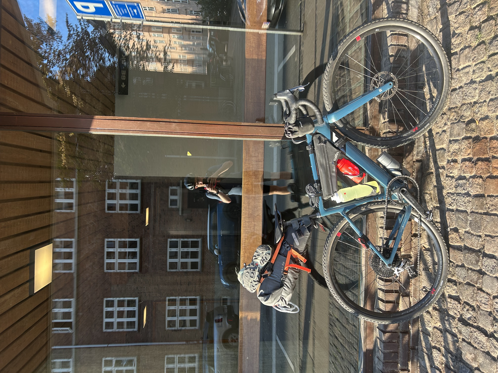

### Day 1: Køge - Heiligenhafen, 159km
In hindsight, it's funny that I skipped the first 40km of such a long trip. This was the first of the two times in those eleven days that I let my thoughts win. With the excuse that the first 40km were pretty boring, I took the S-tog from Nordhavn to Køge. Luckily, François joined me until the ferry, which made the first day way easier. It felt like one of our usual weekend rides, and it postponed the realization of what I was doing until the afternoon, when I took the ferry to Germany. On top of that, he had already done the trip twice, so he knew the roads and the right supermarket to stop at.

After the ferry I had 30km left, but it was only 4pm, so I really tried to enjoy them. I put *Let in the Light* by Moderat on repeat and looked at the sea by my side. What made me feel relieved was reaching the hotel early, so I had plenty of time to start the routine I would repeat every day: shower, wash the cycling kit, go to the supermarket to buy fuel for the next day, and find a place to eat. I even managed a short tour of this German holiday town.

HIGHLIGHTS OF THE DAY:
- The road approaching Præstø was really nice: we descended from some gravel roads down to sea level with a view of the town. That's also where I started seeing lots of people on electric bikes with bags, riding in the opposite direction towards Copenhagen;
- Not being alone, and having my friend François with me on the first stage;
- Burg auf Fehmarn looked like a nice holiday stop, with the main square full of cafés, ice-cream shops and people on holiday;
- The characteristic beach chairs on Heiligenhafen's beach, which I discovered are all over the beaches in northern Germany. A bit different from the seaside I'm used to in Italy.
<!-- Gallery example: swap in your own photos and captions, one per line.
     Swipe on phones, Prev/Next buttons or arrow keys on a computer. -->
<!-- :::gallery
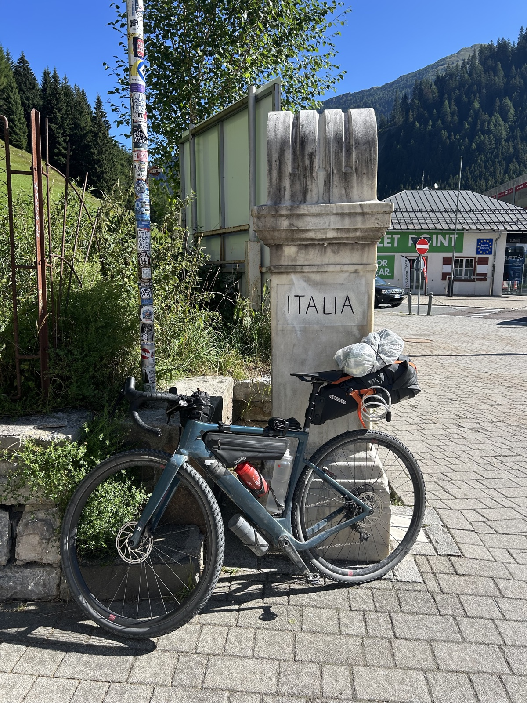

::: -->

### Day 2 Heiligenhafen - Uelzen, 200km:
I had a plan: wake up early, around 6am, have breakfast, and hit the road by 7am, since I had 200km of super flat riding on the menu. The plan failed because the hotel I was staying at only served breakfast from 8am. So I had no choice but to accept it and hit the road at 8:30 after refueling. 200km is a lot, but in theory I'd still make it in about 10 hours.

The first 70km to Lübeck were pretty amazing, maybe because I was realizing that the adventure had actually started. I mostly passed through small towns, lots of farms, and woods. Reaching Lübeck before 1pm was a win for my morale, thanks to the tailwind that pushed me the whole day. I made a quick stop for some touristy pictures and something to eat.

After Lübeck, it was mostly gravel roads along the canals, first the Elbe-Lübeck Canal and then the Elbe Lateral Canal. The night before, I was really worried about getting bored on this second part, so I changed the route a bit to leave the canals. That turned out to be a suboptimal decision: I ended up zigzagging a lot, catching more headwind, and eventually running low on energy. Luckily, music helped, and I managed to get back to the gravel road along the canal and reach Uelzen smoothly.

Then the usual routine started: shower, wash the kit, and a trip to Kaufland. The town felt a bit strange. Everything was closed (maybe because of the summer holidays), there weren't many people around, and it was hard to find a place to eat. I also discovered something that would be a constant over the next few days: in this part of Germany, a lot of places don't really accept cards.

HIGHLIGHTS OF THE DAY:
- Riding through the countryside, surrounded by farms and tractors, reminded me of my hometown. It's something I realized I missed a bit in Copenhagen;
- Edeka supermarket on the way. I discovered something that was always making me happy on this trip;
- All the different types of boats on these two canals.

### Day 3: (train from Uelzen to Gifhorn) + Gifhorn - Bad Lauterberg im Harz, 126km:

This was the other day on the trip when I let my thoughts win. The plan was 196km, with the first real climb towards the end of the stage, through the Harz National Park. I woke up realizing I hadn't eaten enough the night before, and despite a big breakfast I felt low on energy. So I took a regional train to skip 60 mostly flat kilometers along the Elbe Lateral Canal and went straight to Gifhorn. In hindsight, I shouldn't have taken it, because one way or another I would have made it anyway. But I can't change the past.

My legs weren't cooperating in the first part of the stage, and I constantly felt like I was running on empty. I had some intermediate goals before the climb: first Braunschweig, then Goslar, then the climb itself. But I had the feeling I was circling around Braunschweig forever without ever actually reaching it. After that, the scenery started to change and the road got a bit hillier. In Goslar, I stopped for coffee and cake to refuel before going up.

The first part of the climb, on a small road through the woods, was demanding. Then I joined the main road, it got less steep, and I comfortably reached the top. From there, I turned onto gravel for a series of ups and downs towards Clausthal-Zellerfeld. I was really excited about the upcoming gravel descent, but I got Komooted. Indeed, the road marked as gravel was actually worse than a MTB trail, and there was no way I could ride it. So I ended up descending at high speed on the main road, which at some point turned into a four-lane road. So it felt like being in a highway, but I never seen a signal indicating that I was entering a highway. Cars and trucks were flying past me, and I was nervous, with the constant feeling that I shouldn't be there. After checking Maps several times, I found a way off that strange road and made it down to Osterode am Harz.

After a quick look at the city center, I slowly rolled to my hotel in Bad Lauterberg im Harz, arriving at a reasonable time. In the end, taking the train was a smart move after all. The hotel served dinner at 6pm, and if I had arrived later there wouldn't have been much left. Plus, around 7pm it started pouring.

HIGHLIGHTS OF THE DAY:
- Passing through Braunschweig, I got the impression it's an interesting city, where modern architecture and historic buildings fit nicely together. I knew nothing about it apart from the football team, so it was a pleasant surprise;
- Göslar was a really interesting town, full of history it seemed;
- The Harz National Park and its surroundings seemed really cool. I only saw one side of it, but it looks worth coming back to explore more.

### Day 4: Bad Lauterberg im Harz - Meiningen, 148km:
In my head, this was the queen stage of the trip to Nürnberg. It had the most climbing, and the weather forecast I'd been checking since before I left predicted a lot of rain, which made me a bit nervous. All the train alternatives I looked at were bad, with at least four changes to reach the city I'd planned for the stage. So there was nothing I could do but ride and hope to avoid the rain.

The stage can be divided into three parts. The first was like a spring classic, full of short but extremely steep climbs, both on tarmac and gravel, through crop fields and woods. In Italian we call them "muretti". The second part was rolling terrain, mostly gravel, in the middle of a national park. The last was a steep climb through the woods and the descent on the other side.

The whole day I was chased by strong storms, and at one point I had to quickly replan because I got Komooted again and ended up in the middle of a forest where the path just disappeared. On top of that, I got my only puncture of the trip, in the middle of nowhere. The sealant didn't work properly, but luckily I managed to fix it with a plug. From then on, though, I couldn't stop thinking about puncturing again. I stayed fairly dry until the end of the big final climb, but then the storm caught up with me. I took the gravel descent as fast as I could, taking risks I should have avoided, because I hadn't seen a single person all day and really didn't want to get caught in a storm on a hill in the middle of the woods. It was the day I thought the most about the fact that if something bad happened, they would have found me a week later. It made me rethink my route planning a bit.

I made it out of the woods, and then it started pouring. I stopped to put on my rain gear, but I was already soaked and the temperature had dropped a lot. In the end, I rode in the rain to the nearest station and did the last 10km by regional train.

HIGHLIGHTS OF THE DAY:
- Despite the constant ups and downs, I rode through some beautiful woods on nice gravel roads, especially in the first part and in the Hainich National Park;
- I particularly enjoyed the Kanonenbahn-Radweg, a nice bike lane along an old railway line;
- At some point I passed a weird red hill that made me feel like I was on Mars. I later found out it was the Kalihalde Bischofferode, an artificial hill made of waste from potash mining.

### Day 5: Meiningen - Nürneberg, 180km:
This was a big day. Waking up that morning meant I was about to reach Nürnberg, the first goal of the adventure. On top of that, I was going to see Andrea and Noemi and spend a rest day with them, so I was pretty excited. I had 180km to go, so I was happy to see that breakfast started at 6:30. I set the alarm for 6, took a shower, and went to the breakfast room, but the door was locked. That's when I realized it was Saturday, and breakfast was at 8. I had to wait, and I ended up hitting the road at 9:13. But I was not strssing out this time as the hotel reception in Nürnberg was open until 10pm, and in the worst case I had friends there who could have hosted me.

The plan was clear. The main challenge was reaching Bamberg. From there it would get easier, and I'd also pass through towns I knew from a visit two years earlier. For the first 60km my body was't cooperating. I was really suffering on short climbs and on terrain that Komoot thought was gravel but was actually a non-existent path through the fields. Then I started to see the light. Maybe it was thanks to the gels I took, or maybe my mood got better because I noticed I was entering Bavaria, with its typical towns, and all the Christian symbolism saw this poor man on a bike pedalling squares and decided to help him a bit.

From Bad Königshofen, I rode a super long stretch of big, smooth, rolling gravel roads immersed in the woods. Along the way, I discovered it's called the "Rennweg Radroute", and I think it was one of the highlights of the whole trip. It ended about 8km from Bamberg, and for most of that stretch I didn't meet a single person.

In Bamberg, I took some time to walk past the main tourist attractions and check out the Schlenkerla brewery, but just from the outside, because the city was packed with tourists on a Saturday in the middle of summer. From there, I followed the Main-Donau Canal until close to Nürnberg, where some construction sites made me miss a turn (I mean there were some indication but I was not expecting that we would have been able to pass under that huge canal in any way, so I decide to "keep the liiineeeee" (cit.)). I smartly thought that by following the canal I would reach the city center, but quite a while later I realized that Nürnberg has more than one canal, and I was following the wrong one. I did a U-turn, quickly found the right way, and made it to Nürnberg in time to meet my friends for dinner.

HIGHLIGHTS OF THE DAY:
- Definitely the "Rennweg Radroute." It reminded me of Swedish gravel: compact and rolling, in the middle of the woods;
- Spending time with my friends and meeting their newborn baby.

<!-- Gallery example: swap in your own photos and captions, one per line.
     Swipe on phones, Prev/Next buttons or arrow keys on a computer. -->
:::gallery
<!--  -->
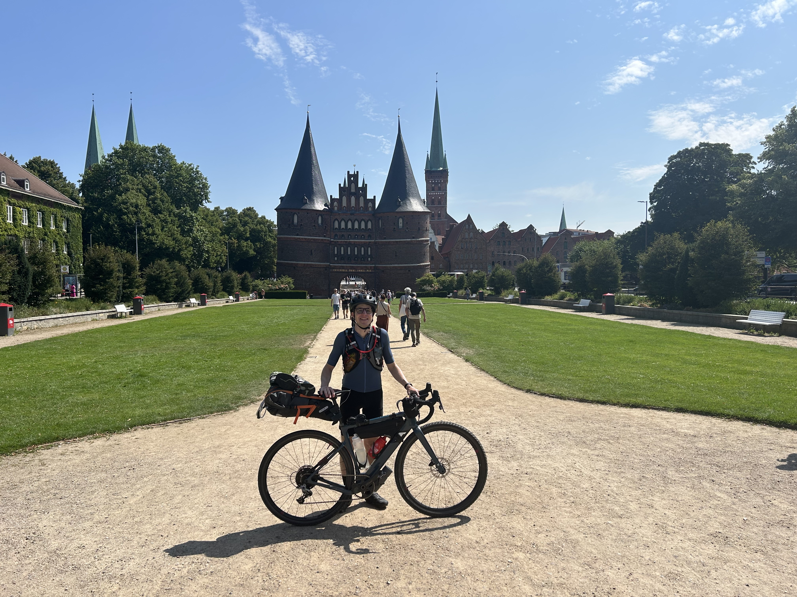
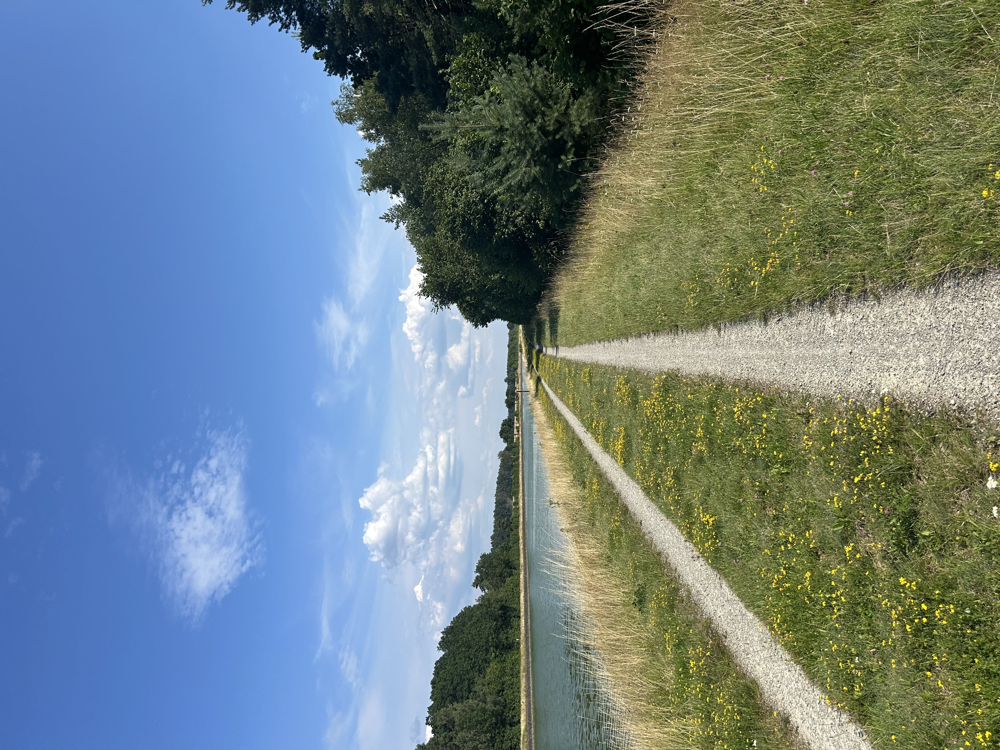
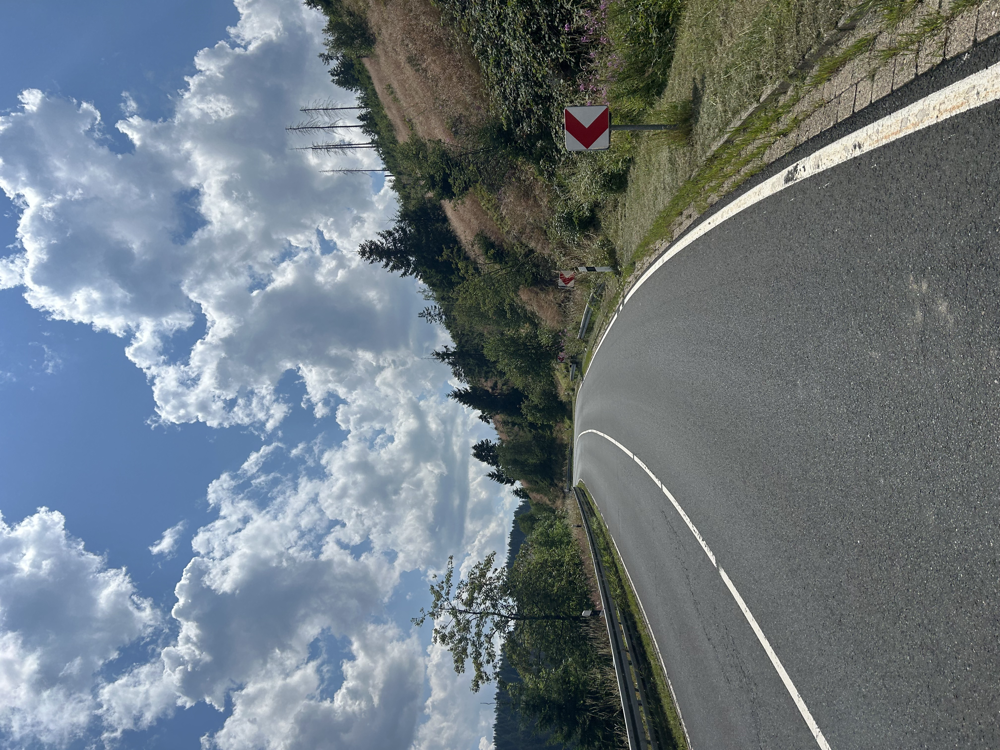
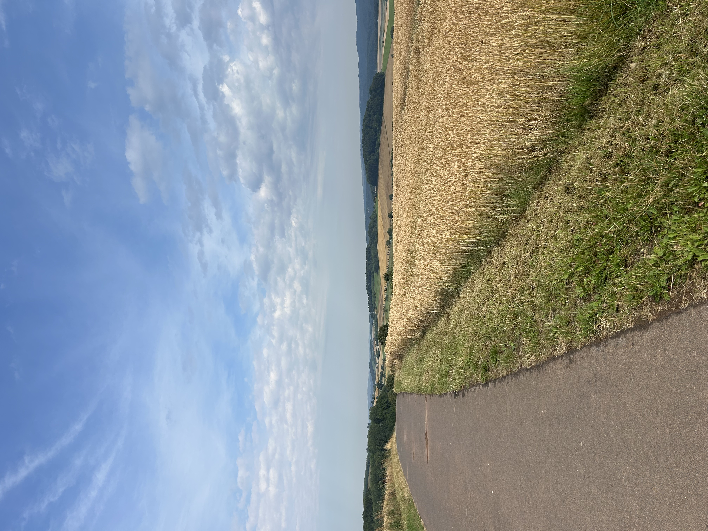
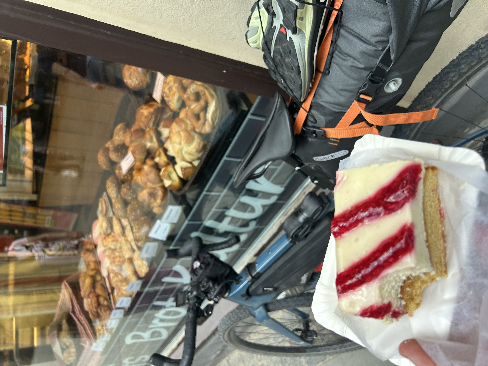
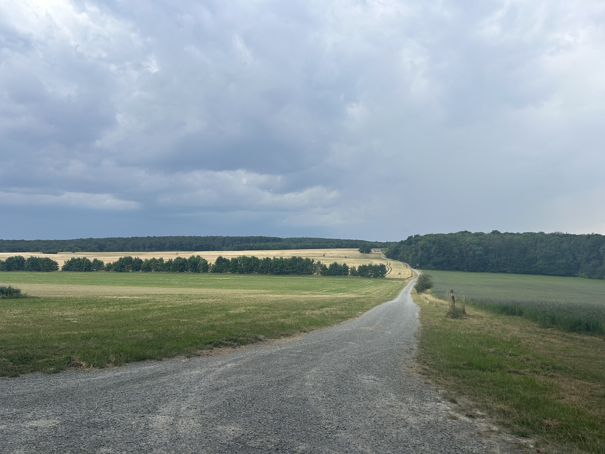
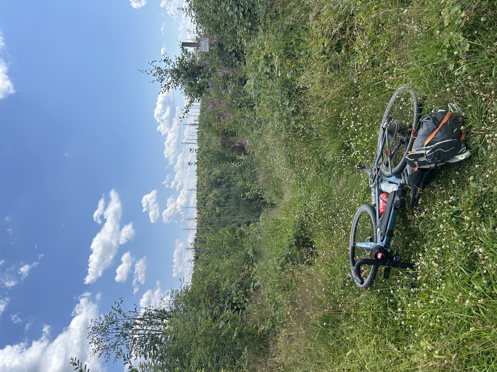
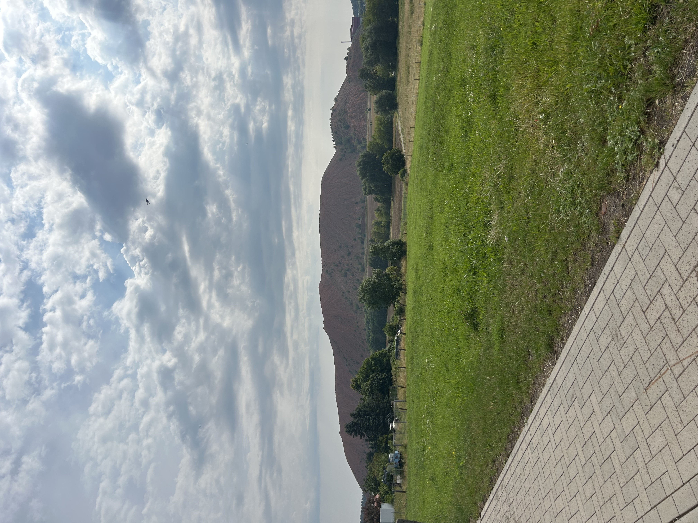
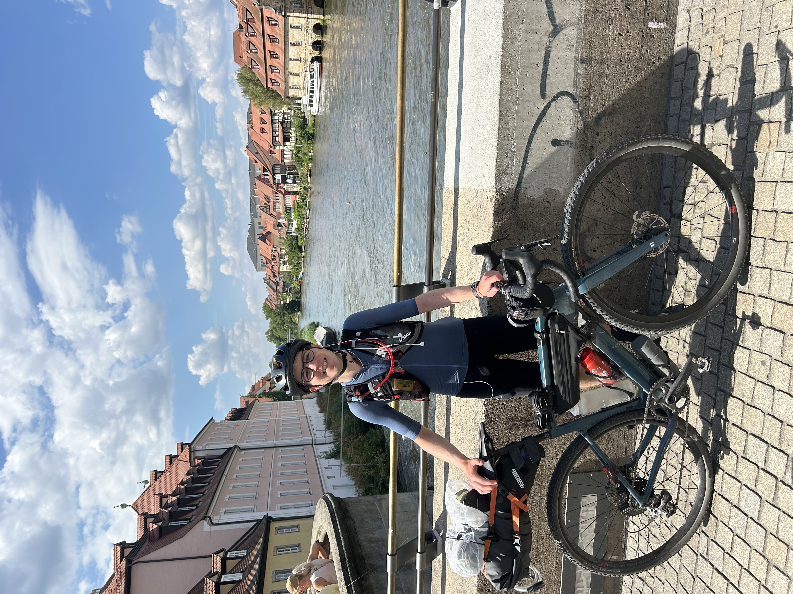
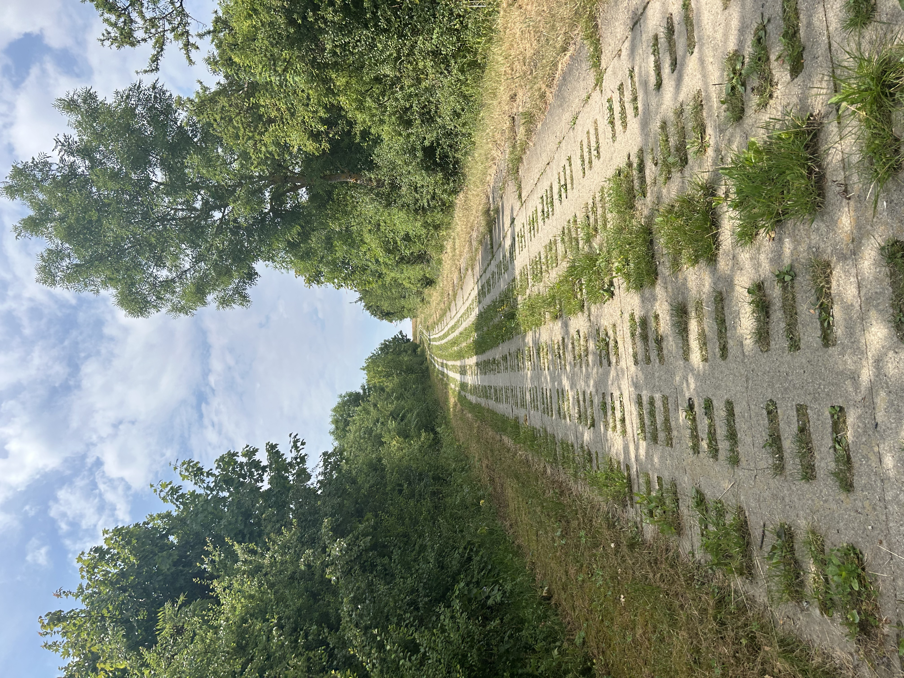
:::

### Day 6: Nürneberg - Donauwörth (+ train to Ulm), 113km:
The well-deserved rest day in Nürnberg came with a surprise. As I said, in the days before departure I had thought about everything that could go wrong and had a plan for almost every situation. I had even started using chamois cream, which I'd never used before, to prevent saddle sores. But my body didn’t respond well to going from an average of 6 hours a week on the bike to 36. I won't go into details, but sitting on the saddle was almost impossible, and resting would have been the best option.

The next stage was a long one, 200km from Nürnberg to Ulm, where I would spend a few days visiting my friend Kilian. I didn't want to give up. Either I took a train straight from Nürnberg to Ulm, or I tried to ride and jumped on a train whenever I reached my limit. I checked the stage and noticed there were train stations all along the way, so I decided to get on the bike, riding out of the saddle more and taking more frequent breaks.

In the end, I managed to ride 113km to Donauwörth. The first part was still along the Main-Donau Canal to the Rothsee, then I passed through Hilpoltstein and some typical Bavarian towns, like Pleinfeld and Weißenburg in Bayern. It wasn't easy at all, and I should have stopped earlier, but at that point you just keep going and think about recovering later. From Donauwörth I took the train to Ulm, where Kilian was waiting for me, and I still managed to enjoy my first night there during the Nabada, the river festival on Schwörmontag. 

HIGHLIGHTS OF THE DAY:
- Finally visiting my friend Kilian in Ulm.

### Day 7: Extra stage: Donau valley from Ehingen to Tuttlingen via Wurmlingen, 139km
We had big plans for these five days together, like riding part of my route and maybe ending up in Ehrwald for some hiking. But both the weather in that area and my physical condition forced us to replan. So five days that were supposed to be about adventures and hikes became five days of slow life: coffees, several schnitzels, and the perfect chance to discover the area around Ulm.

On two of those days, we still went out for some adventure. The first was an 80km ride to the Berg Brauerei for lunch, and then on to Blaubeuren and the Blautopf. For the second, we rode part of the Donauradweg, but in the opposite direction to the one most people take. It was also a test to see if I could handle time in the saddle, or if I had to plan a different way home. After six days riding alone, it was nice to be out with a friend. It actually makes everything easier: you have someone to talk to, and if something happens, you're not alone.

We set out from Ehingen to reach Wurmlingen, where we'd visit Kilian's grandparents and the Hirsch Brauerei. 20km in, he got a flat tyre, and neither of us managed to unscrew the wheel to replace the tube. Luckily, a group of experienced grandpas was just leaving the nearby Gasthaus on their MTBs, and they helped us get it off. They saved us, otherwise it would have been a long walk to Riedlingen.

After that, the ride went really smoothly, and you could really notice the change of scenery once we entered the Obere Donau Nature Park. We stopped at the Jägerhaus im Donautal for lunch (at 3pm), and since we were close to our destination, I had both a plate of spätzle and fries (the carbs were never enough). But then Kilian suggested taking a super steep gravel climb to reach Wurmlingen from above, and being that full didn't help. In Wurmlingen, we visited his grandparents and then headed to the Hirsch Brauerei for a schnitzel and two well-deserved beers. The ride to Tuttlingen station to catch the train was fun too. We were feeling the beers, so flying downhill without feeling our tired legs was a blast.

HIGHLIGHTS OF THE DAY:
- Spending five days in Ulm with my friend Kili
- All the schnitzel and fries I had in those days

### Day 8: Ulm - Oberammergau
I never thought about the Alps until that day. I always believed the hard part was crossing central Germany to reach Nürnberg and then Ulm. That alone was already a victory for me, so I never really thought about the rest of the trip. After five days with Kilian, it was difficult to leave and realize I still had plenty of me time ahead. But at the same time, I was excited about the change of scenery. If there's one reason I love watching the Giro and the Tour, it’s the mountain stages, so I was looking forward to being surrounded by mountains. (After replanning, I'd chosen the easiest way from Austria to Italy, the Brenner Pass.)

But the Brenner was still far away. First, there were 156km between Ulm and Oberammergau. I had promised myself to do short stages so my pain wouldn't get worse, but on the Bett+Bike website, the only accommodation with a reasonable price on my route was in Oberammergau. Since I wanted to take it easy, I said goodbye to Kilian on the outskirts of the city and started the last part of my trip at 7:40.

I don't remember much of the first kilometers, only that I was eager to see the mountains on the horizon, and it took a while for them to appear. Around 11am, I stopped at a café to give myself a break from the saddle and have a second breakfast. I never did that on the previous stages, which shows how calmly I was taking this one. The road was always slightly uphill, but after Kaufbeuren things got interesting, as the landscape started to look like the mountains. I will always remember those 800m at 16% that came out of nowhere to get away from the main road. But after that, I entered the valley of Unterammergau and Oberammergau, and being surrounded by fields with cows and high mountains was truly amazing. I reached the hotel by 4pm, so I had time to wander around the town, which was full of tourists at that time of year.

HIGHLIGHTS OF THE DAY:
- Finally reaching the mountains.

### Day 9: Oberammergau - Matrei am Brenner, 104km 
The plan for the day was to cross the German border, descend into Innsbruck and then start the climb to the Brenner Pass. I kept the stage short to avoid making my physical problems worse: only 105 km, with the whole day to do it. In the end, this was one of the best stages landscape-wise, even though the sky stayed cloudy the whole time.

I left the hotel at 8:47, and the first few km were mostly downhill to Garmisch. From there the road started going uphill, first to Mittenwald, then Scharnitz, and then Seefeld in Tirol. Before reaching Mittenwald, I realized I had a pin on Google Maps for a small lake close to the road I was following (no idea when, or in which Instagram reel, I might have seen it). The lake itself wasn't the most amazing one, which made me wonder why I'd had it pinned for ages, but the path to reach it was amazing: a small gravel road surrounded by mountains and fields full of cows.

There I realized that this was exactly one of the reasons why I had left in the first place. I've always been attracted to mountains and I would love to spend more time in them, but I've never tried driving a car up and down a mountain, so I have a sort of block there. For this reason, I've always seen the bike as the way to reach the places I'd really like to visit. And in that moment I was actually doing it, so I enjoyed every minute, despite the uphill.

I reached Mittenwald and then Seefeld in Tirol, where I made a short stop at the Eurospar to get some drinks. I was excited, because from there it was mostly downhill to Innsbruck. And here, I'm not sure what happened. Either I took a wrong turn or I couldn't follow the directions on my Wahoo, but I found myself with no option other than route 177 from Leithen to Zirl, which has heavy traffic and a 16% gradient. It was awful: there was traffic, the tarmac was in poor condition, and it was freaking steep. On the other side of the road I saw a cyclist going uphill, and I wouldn't have wanted to be in his shoes either. Anyway, I took it super carefully, but my brake pads didn't enjoy it. Only once I was home did I discover that riding a bike downhill on that section is actually prohibited, so I actually did something illegal. Luckily, nobody was there at the time.

From Zirl, it was a freaking boring cycle path with the motorway on one side and the Inn river on the other, which was grey because of the rain of the previous days. I went into the city center, checked out the main touristy spots and stopped at a bakery, since I had plenty of time.

Then I started my climb towards the Brenner Pass. My hotel was right in the middle of the climb, in Matrei. I had two choices, eithr taking the longer way via the Römerstraße, or the more direct way via the Igler Straße to Vill. I had read online that the second one had more traffic, but at that point I just wanted the shortest way to the hotel, so I chose it. And as expected, it was full of cars and trucks, there were annoying roadworks, and there was no infrastructure for cyclists, meaning cars passed super close and didn't really respect the 1.5 m distance. But I know how it works in my region in Italy, so I should be used to it by now.

I reached the hotel around 4pm, so I had time to go to the supermarket and also to sit on the balcony of my room enjoying the view as the sky opened up and it was sunny. Maybe I should have considered staying an extra night there, because the views were amazing.

HIGHLIGHTS OF THE DAY:
- Maybe best day in terms of landscape;
- Also hotel with the best view.

### Day 10: Matrei am Brenner - San Michele all'Adige, 158km 
Today was the day we were entering Italy. It was a big day, because it made it clear that, one way or another, I was going to make it home. Something like 300 km left in total. Initially, the never-optimistic-but-sometimes-optimistic Federico had planned to wake up at 4am and make it home in one go. Just to make an adventure inside an adventure and to emulate the ultracyclist I follow on Instagram. But my physical problems, plus the fact that the hotel owner made me pay in the morning after breakfast, forced me to split the remaining kilometers into two more stages.

I left the hotel at 8:39 after the usual big breakfast, ready for the last 17 km of the Brenner Pass. It was cool and my legs were still waking up. Here too there was no infrastructure for cyclists, so I was just sharing the road with cars and trucks heading towards Italy.

A few km from the border, on a false flat with a 2–3% gradient, another cyclist with no bags passed me. He wasn't going much faster than me, maybe just 2 km/h, so I decided to stay on his wheel and use him to shelter me from the wind. Maybe it was just my competitive side: I'm fine with people who are stronger than me passing me, but he clearly wasn't, and that triggered me. Indeed, when the 9–10% section started, his speed dropped a lot even without bags, so I passed him and kept a strong rhythm so he couldn't follow, and I reached the border a few minutes before him. (Clearly this challenge, this sort of “dick-measuring contest”, was only in my head, but it was fun to ride those km in race mode, even though the guy was most likely over 50.)

At the border there wasn't much, to be fair, just a stone marking it. I stopped a few minutes for the usual picture and then started the descent, first towards Gossensass and then Vipiteno, with an extra boost of morale. After a walk around Vipiteno's city center, I headed towards Brixen. The good thing was that most of today's route was on cycle paths, but before Brixen there were some roadworks that forced me to take a detour, including a hike-a-bike section through the woods. At first, the detour was nicely marked with those yellow road signs, but after a while they disappeared, which made me second-guess every decision at every intersection. I hated it, because we were kind of circling around Brixen without actually reaching it, and I didn't want to add more km to this stage. Luckily, I made it to Brixen, where I refilled my water and kept riding towards Klausen, where I stopped at a bakery for lunch.

The way to Bozen was pretty boring, I'd say: mostly a cycle path along the main road, no nice views and mostly headwind. It was also the first day of the whole trip with temperatures above 30 degrees. I arrived in Bozen, rode around the city center a bit and stopped for an ice cream to cool down.

I had a weird realization there, which is difficult to explain. There's something I like about having everything you need in two bags attached to the bike, wearing cycling clothes and just showing up places. It's kind of the feeling of being free from all the social norms and constructs we have in our daily life. It's like zero appearance: you get rid of the need to show something to others. I got my ice cream and sat on the ground, because I was dirty and sweaty anyway. A normal thing to do, but one that nobody does on a normal day. Not sure I've explained myself well, but I felt free, or maybe just free from other people's opinions and judgements.

Anyway, it was almost mid-afternoon and I still had 2 hours of riding to the hotel, so I left right after. I was staying a bit outside Trento. This last stretch wasn't super exciting either, just a cycle path along the Adige river with lots of apple trees completing the landscape. I reached the hotel, repeated the usual routine for the last time, got a pizza for dinner and went to bed with the nice feeling that the next day was the last one: I was close to home and could take everything very calmly.

HIGHLIGHTS OF THE DAY:
- Reaching Italy after a race (just in my head) with a fellow cyclist;
- The town of Klausen and eating icecream in Bozen;
- To reach Brixen I went through a nice downhill with a view on the valley full of vineyards. 

### Day 11: San Michele all'Adige - Onara, 138km
Last day of the trip. There was only one last challenge on the stage, a short climb from Trento to Caldonazzo, and after that it was mostly roads I had ridden at least three or four times. Not exactly home roads, but I knew the places. I wanted to sleep more, but the later I left the hotel, the hotter it was forecast to be. So I woke up at 8, hit the road at 9 and started sweating immediately because of the humidity and the 28 degrees.

The climb to Forti di Civezzano wasn't super hard, although some sections were pretty steep and took a bit of a toll on my legs. I descended to Pergine, and on my way to Caldonazzo I felt like I was missing some freshness and energy in my legs, despite the pizza and the breakfast. So I took a gel, which I felt really helped me (or maybe it was just a mental switch), and reached Calceranica. From there I kind of remembered the roads, as I had done small bike trips there with friends more than 10 years ago.

From there I just had to follow the Brenta river to Bassano. I took it really easy: I had the entire day, so I really tried to enjoy those last moments. On top of that, my sister asked if I could arrive after 4pm so she could see me arrive. So I stopped along the Brenta to put my legs in the water, and I knew that on the way there was a Bike Grill that I had always seen but never stopped at in my entire life. When I reached it, I parked the bike and had lunch.

While I was having a toast and a Fanta, a guy on a bike with bags stopped as well and asked if he could join me for lunch. That was the first real interaction I'd had in almost 1,700 km. The funny thing is that he's German but also works in Copenhagen, and two days earlier he had been in Mittenwald, where he started his trip to Eraclea, where his wife is from. The world really is small. We ate and then shared the road to Bassano del Grappa, alternating small chats and taking turns at the front. Time flew, and I told him he should definitely stop in Bassano because there's some nice historical stuff, like the Ponte Vecchio. So we stopped there and had an ice cream. We chatted a bit more, but then it was time for me to finish my adventure, while he headed towards Asolo.

I put my music back on and, with the energy I had left, time-trialled the remaining part of the stage to Onara. I quickly passed through Cittadella, and then I had the last 5 km left. I tried to think about the whole adventure during those km, but it was hard to realize I had made it. I wasn't able (and maybe I'm still not able) to realize that I had left from Copenhagen and reached home by bike. At home, my mum and my younger sister were waiting for me, and it was a nice feeling to arrive not at a random hotel, but actually home.

HIGHLIGHTS OF THE DAY:
- Finding Till, a fellow bikepacker and sharing part of the road with him;
- The feeling of reaching home.

:::gallery
<!--  -->
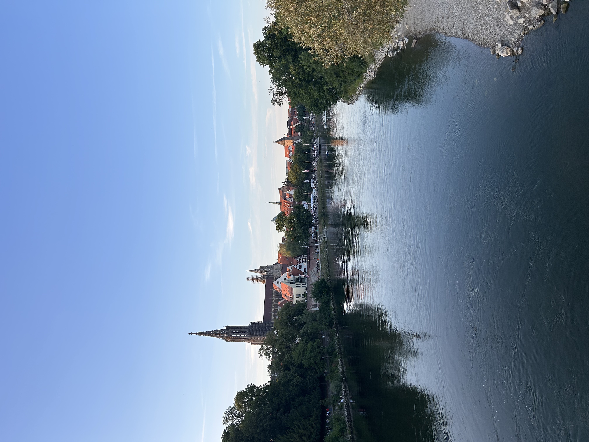
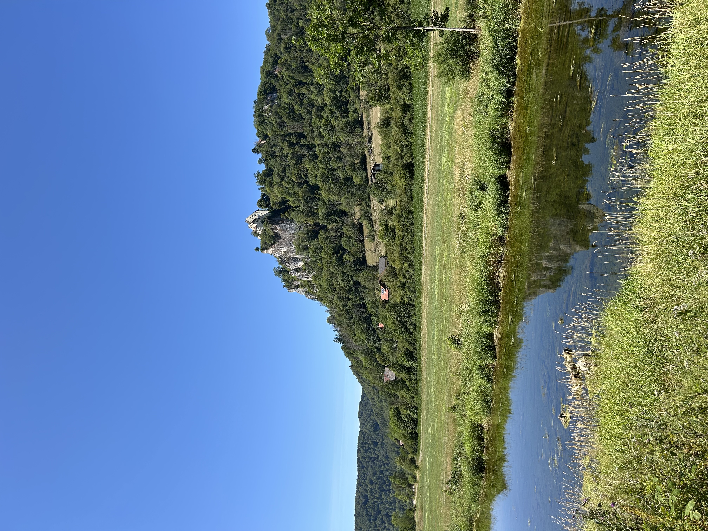
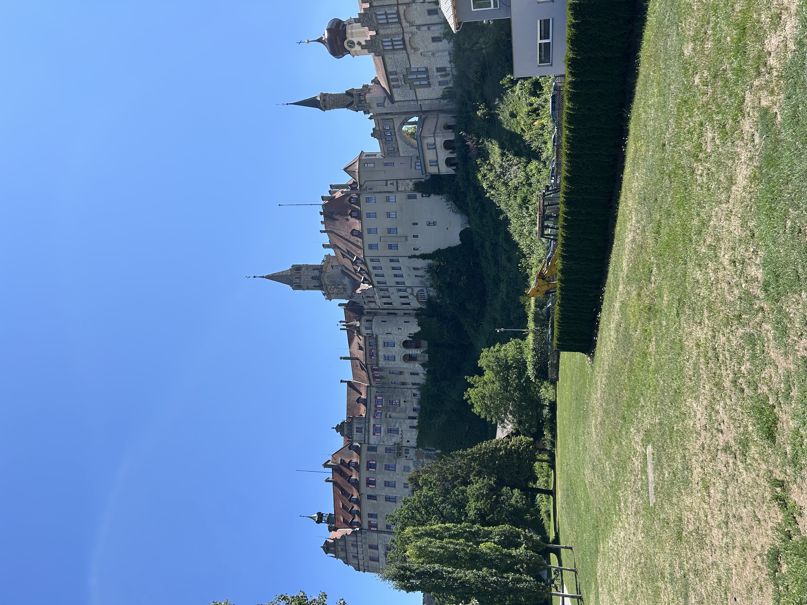
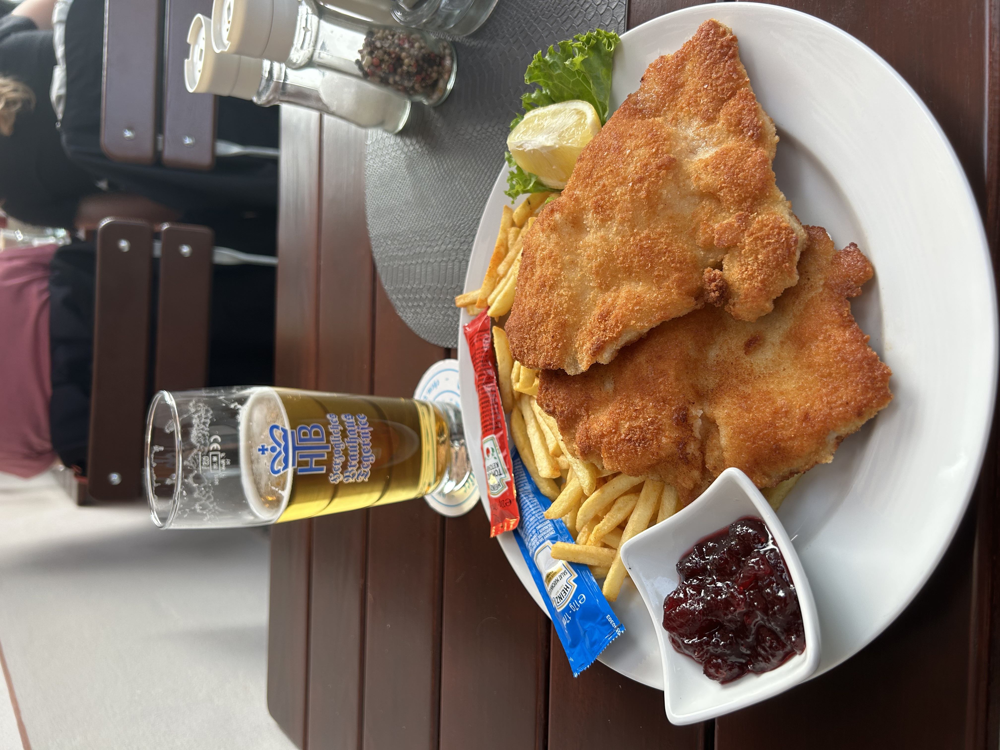
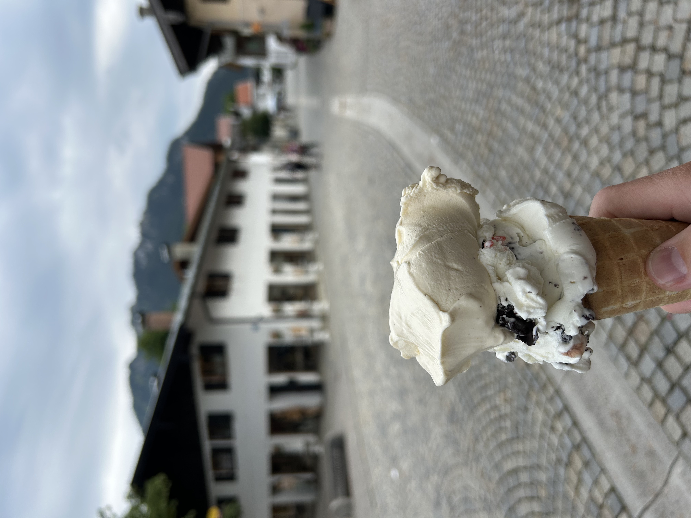
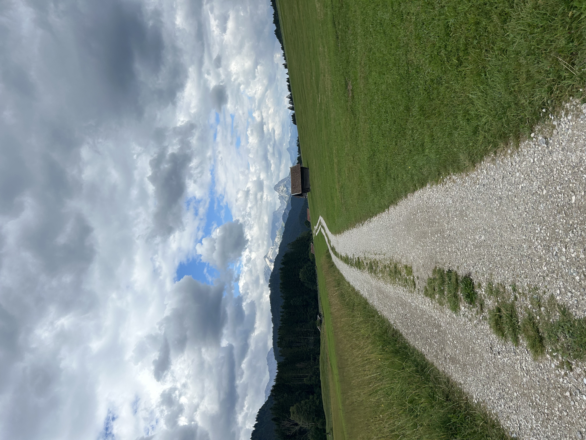
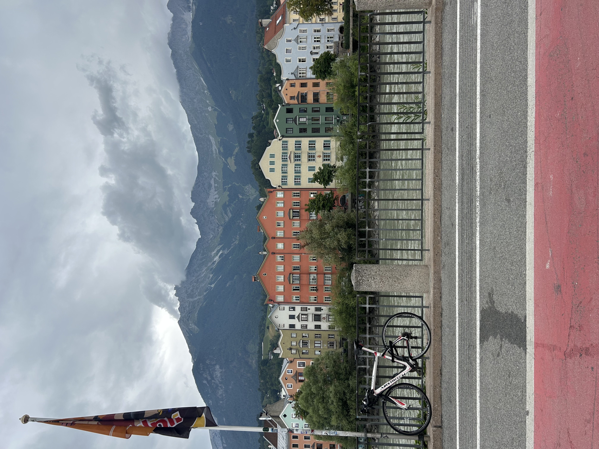
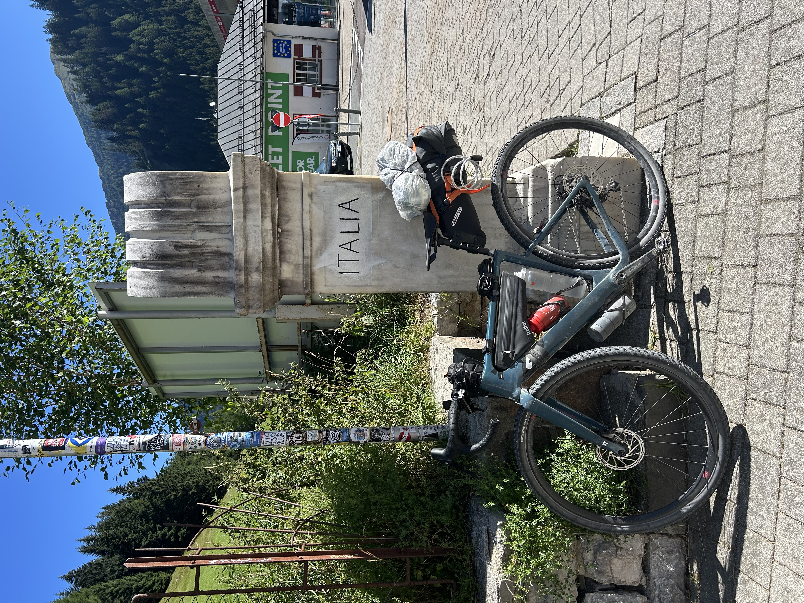
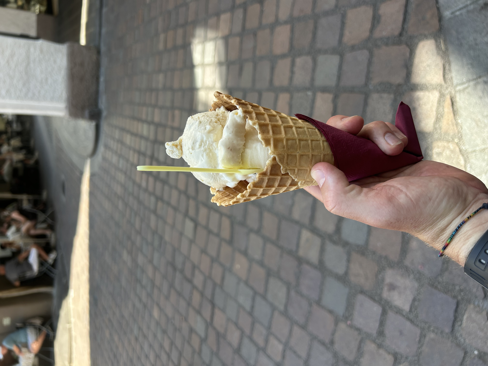
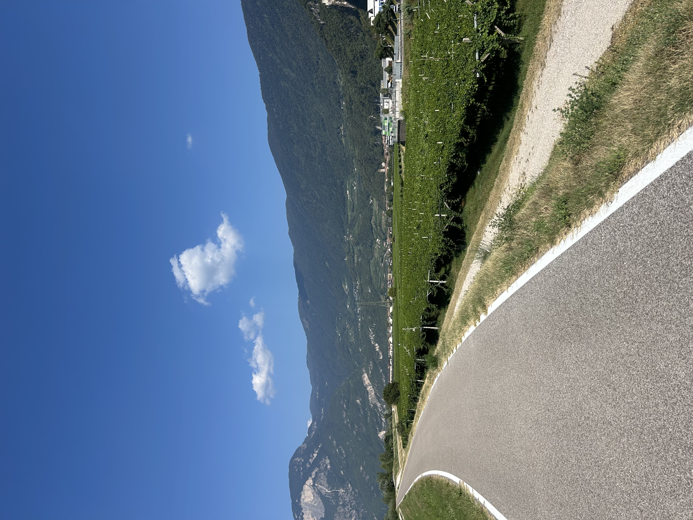
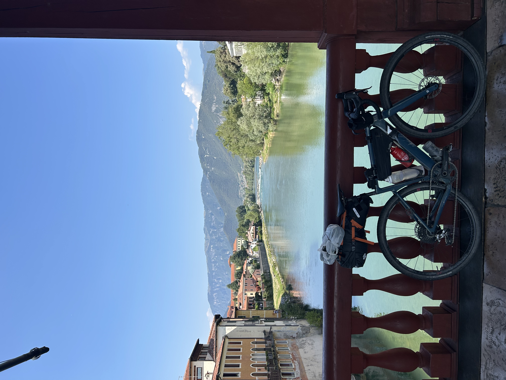
:::

<!-- Gallery example: swap in your own photos and captions, one per line.
     Swipe on phones, Prev/Next buttons or arrow keys on a computer. -->
<!-- :::gallery

::: -->

### Specs for the nerds

Nobody cares, I know. I just wanted to feel like the pros.
- Bike: 3T Ultra
- Tyres: Pirelli Cinturato Gravel M (700x45 in front, 700x40 at the back. I know the pros do this, but I had to because the 700x45 I bought didn't fit at the back)
- Gears: a Frankenstein setup, and definitely not enough when the gradient went above 12%
- Bags: Ortlieb Seat-Pack 16L + Tailfin 2.7L Wedge frame bag + USWE backpack with 2L hydration pack
- All stages are on my [Strava profile](https://www.strava.com/athletes/8645172), with more pictures and videos

### Reflections on the trip

I always had the idea that adventures like this one, or walking the Camino de Santiago, are the perfect setting to spend time alone thinking about the big questions in life. And to be fair, I was also planning to think about all the questions I'd had in the weeks before leaving. But nope, that didn't happen. Yes, I had plenty of time to think, but not about any big questions. If anything, I feel these adventures are the opposite. You don't do them to find answers. You do them to get rid of the questions. In those days, the only things on my mind were eating and drinking enough, not overdoing it on certain parts of the stage, and not taking stupid risks off-road. Everything happening in the world, or in my life before I left, just didn't matter anymore. And that was a good feeling.

I was also a bit disappointed by how little people seem to care nowadays (that sounds like a classic old-person complaint, but hey, I'm a boomer). Okay, I'm an introvert myself, but I was stopping at hotels, supermarkets and cafés in small towns, showing up in cycling clothes with a bike full of bags, so I expected some conversations to start just out of curiosity. That didn't happen. Either people are used to it, or they just don't care anymore, and that made me a bit sad.

After several nights in "cheap" hotels, I started to appreciate the family-run ones. You can really tell they care a bit more, especially at breakfast. On those mornings, I left happy to have supported a family-run place.

### Songs I listened to on repeat during those long days in the saddle

- [Robina - Rareş](https://www.youtube.com/watch?v=8DkRjzPVGms), [Hanno previsto pioggia - Rareş, faccianuvola](https://www.youtube.com/watch?v=l_Xp_h40PcM): I only put two songs here, but I found myself loudly singing his whole album several times on the road. This was definitely the soundtrack of the trip;
- [Let in the Light - Moderat](https://www.youtube.com/watch?v=9bubwD-K4Os): I rediscovered this track while scrolling Instagram on the ferry. Kasia Niewiadoma shared it in one of her posts, it matched my vibe perfectly, and I kept listening to it in the following days;
- [fiori/posto sbagliato - faccianuvola, fenoaltea](https://www.youtube.com/watch?v=RhVcSR86P0k): there's a part in the pre-chorus (in Italian, obviously) about not letting the fear of dark clouds overcome you, and to me it always felt like an invitation to keep going;
- [VHS - Swimming Paul](https://www.youtube.com/watch?v=dmxJIc3M7LI), [Hard2Sleep - Swimming Paul](https://www.youtube.com/watch?v=CRSKic2p7E0), [To This Day - Swimming Paul](https://www.youtube.com/watch?v=_h4tW-kmZeA), [Good Night Baby - Daphni](https://www.youtube.com/watch?v=x-YlWi6Rqdo): these four songs were on repeat almost every time I had to go uphill, especially on the gravel climb from Bad Tabarz to Tanzbuche, while being chased by one storm after another;
- [Evoluzione - Linea77](https://www.youtube.com/watch?v=GKAO5OtS9JE): I rediscovered this song I used to listen to in high school. It really helped every time I was pedalling squares or felt like I had no energy left;
- [Tempo - Nerissima Serpe, Latrelle, Promessa](https://www.youtube.com/watch?v=EuB1FzFRM3Y), [Famiglia - Nerissima Serpe, Papa V](https://www.youtube.com/watch?v=IDToYOqfiR8), [Non sembriamo felici - Promessa](https://www.youtube.com/watch?v=Dzc7ROPYsv0): I don't know, these are mostly introspective songs that matched my mood in the mornings, when I was leaving the hotel and heading into the unknown again, mostly questioning myself.

*I'd also like to thank all the friends who checked on me every day. It meant a lot during those days.*